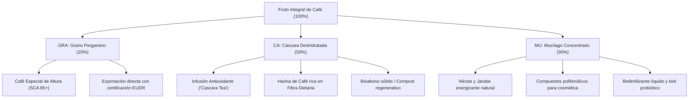

# DOSSIER TÉCNICO Y CIENTÍFICO: PROYECTO GRACAMU IKAM 2030
### "Caficultura Regenerativa, Bioeconomía Circular y Tecnología Limpia en Origen"
**Instituto de Educación Superior Tecnológico Público de Excelencia "Perú Japón" — Chachapoyas, Amazonas**

---

## 1. RESUMEN EJECUTIVO

El proyecto **GRACAMU IKAM** es una iniciativa de Investigación, Desarrollo e Innovación (I+D+i) y emprendimiento tecnológico nacida en el **IESTP de Excelencia Perú Japón**. Su propósito es transformar radicalmente el modelo tradicional de beneficio del café en el departamento de Amazonas, sustituyendo el uso intensivo de agua y el vertido contaminante de efluentes por un sistema de **despulpado fraccionado en seco, portátil y autónomo**.

A través del aprovechamiento integral del fruto del café:
* **GRA (Grano):** Café pergamino especial sin daño mecánico ni sobrefermentación.
* **CA (Cáscara):** Biomasa deshidratada para infusiones antioxidantes y harinas funcionales.
* **MU (Mucílago):** Extracción no diluida de polifenoles y azúcares fermentables para nutracéutica, cosmética y bioestimulantes.
* **IKAM:** Término de la lengua originaria Awajún (*selva/bosque*), resignificado tecnológicamente como *Innovación y Recolección Ambiental del Mucílago*.

---

## 2. RADIOGRAFÍA Y MÉTRICAS DEL ECOSISTEMA CAFETALERO EN AMAZONAS

### 2.1. Cifras Clave de la Región (MIDAGRI / INEI / JNC)

| Indicador Regional | Dato Oficial | Fuente de Referencia |
| :--- | :--- | :--- |
| **Unidades Productoras de Café** | Más de 40,000 parcelas registradas | MIDAGRI / Padrón de Productores Agrarios (PPA) |
| **Productores Registrados en Cadena Café/Cacao** | 40,835 productores activos | Plataforma Oficial MIDAGRI - Amazonas |
| **Estructura Agraria Predominante** | > 80% Agricultura Familiar de Pequeña Escala (< 5 ha) | IV CENAGRO / INEI |
| **Cuencas Cafetaleras Principales** | Utcubamba, Rodríguez de Mendoza, Bagua, Bongará y Luya | Compendio Agropecuario Amazonas |
| **Organizaciones y Cooperativas Activas** | Más de 45 asociaciones y cooperativas agrarias | Directorio Nacional de Cooperativas - JNC |
| **Cooperativas Representativas** | COOPARM, Flor de Café, Laguna de los Cóndores, APROCAM, etc. | Junta Nacional del Café (JNC) |

### 2.2. Problemática Crítica Identificada

#### A. Pérdida Masiva de Biomasa (80% Desperdiciado)
En el proceso de beneficio húmedo convencional, únicamente el **20% del fruto fresco corresponde a los granos de café**. El **80% restante (cáscara/pulpa y mucílago)** es considerado residuo y descartado de forma indiscriminada.

#### B. Catástrofe Ambiental: "Aguas Mieles" en Cuencas Amazónicas
El mucílago disuelto en agua genera efluentes con altísima Demanda Química de Oxígeno (DQO) y Demanda Bioquímica de Oxígeno (DBO):
* Acidificación severa de ríos y riachuelos tributarios del Marañón y Utcubamba.
* Muerte de fauna acuática por hipoxia (desoxigenación del agua).
* Proliferación de vectores y degradación de suelos de ceja de selva.

#### C. Presión Internacional y Normativa Europea (EUDR)
La Unión Europea exige el cumplimiento del **Reglamento sobre Productos Libres de Deforestación (EUDR)** y límites máximos de residuos agroquímicos. El modelo tradicional de Amazonas arrastra:
* Dependencia de pesticidas y fertilizantes sintéticos para combatir la roya (*Hemileia vastatrix*) y la broca (*Hypothenemus hampei*).
* Riesgo inminente de cierre de mercado en Europa para pequeños caficultores que no demuestren trazabilidad y sostenibilidad ambiental.

#### D. Ineficiencia en Cosecha y Daño Mecánico
* Las despulpadoras mecánicas tradicionales requieren grandes volúmenes de agua corriente (imposible de suministrar en laderas empinadas sin mangueras o bombeo).
* Descalibración de tambores que produce entre 5% y 12% de granos quebrados o aplastados, degradando el puntaje en taza (SCA).

---

## 3. PROPUESTA DE VALOR: SISTEMA PORTÁTIL AUTÓNOMO GRACAMU IKAM

El equipo ha diseñado un **Sistema Portátil Autónomo de Cosecha y Despulpado Fraccionado en Origen**, concebido específicamente para la topografía agreste de selva alta.

### 3.1. Arquitectura de Ingeniería y Componentes

```
[ Fruto Maduro ]
       │
       ▼
┌──────────────────────────────────────────────┐
│ 1. Tolva de Alimentación & Cribado Primario  │ ➔ Retención de ramas, hojas y piedras
│    (Acero Inoxidable AISI 304)               │
└──────────────────────────────────────────────┘
       │
       ▼
┌──────────────────────────────────────────────┐
│ 2. Tambor Despulpador Dual Micrométrico      │ ➔ Regulación micrométrica (4 mm - 8 mm)
│    (Acero Grado Alimenticio 304)             │    Cero grano quebrado (Típica, Caturra,
└──────────────────────────────────────────────┘    Bourbon, Pache)
       │
       ├─────────────────────────┬─────────────────────────┐
       ▼                         ▼                         ▼
┌──────────────┐          ┌──────────────┐          ┌──────────────┐
│ GRANO SECO   │          │ CÁSCARA PURA │          │ MUCÍLAGO     │
│ (Pergamino)  │          │ (Sin mezclar)│          │ CONCENTRADO  │
└──────────────────┘          └──────────────┘          └──────────────┘
```

1. **Tolva y Cribado Primario Superior**:
   * Embudo cónico de aleación ligera y acero inoxidable 304.
   * Rejilla selectora desmontable que evita atascos y contaminación por hojas o piedras.
2. **Tambor Despulpador Dual Micrométrico**:
   * Rodillo dentado concéntrico en acero quirúrgico/alimenticio.
   * Perilla con escala micrométrica (4 a 8 mm de holgura adaptable a la variedad botánica).
   * **Despulpado ecológico en seco (0 litros de agua por quintal)**.
3. **Módulo de Energía Híbrido Tri-Fuente**:
   * **Panel solar monocristalino** plegable integrado en la cubierta del equipo para recarga pasiva.
   * **Batería LiFePO4 de 24V** (Litio-Ferrofosfato), alta seguridad térmica y más de 3,000 ciclos de vida útil.
   * **Manivela retráctil de acople rápido** para tracción manual en jornadas con lluvia o descarga accidental.
4. **Chasis Biomecánico y Ergonomía de Campo**:
   * Estructura ultraligera de aluminio estructural con arnés lumbar acolchado.
   * Textil técnico *ripstop* impermeable de alta resistencia a lodo, espinas y roces en pendientes mayores a 45°.

---

## 4. LA BIOECONOMÍA CIRCULAR: EL MODELO GRA - CA - MU



---

## 5. FILOSOFÍA ANCESTRAL: IDENTIDAD IKAM Y NÚGKUI

* **NÚGKUI (Madre Tierra en la cosmovisión Awajún):** Protectora de la fertilidad del suelo y guardiana de los cultivos.
* **IKAM (Bosque / Selva Viva):** El proyecto asume el compromiso ético de no despojar a la naturaleza de su equilibrio, reintegrando los nutrientes a la tierra y protegiendo el agua para las futuras generaciones de Amazonas.

---

## 6. DIRECTORIO DEL EQUIPO DE INVESTIGACIÓN (IDEX PERÚ JAPÓN)

| Rol / Estamento | Nombre Completo | Especialidad / Función |
| :--- | :--- | :--- |
| **Dirección Institucional** | Dr. Mario Y. Torrejón Arellanos | Director General del IESTP Perú Japón |
| **Docente Asesor** | Ing. Otto Mori Tuesta | Asesor Agroindustrial y Sostenibilidad |
| **Docente Asesor** | Dr. Manuel Jesús Quispe Narváez | Asesor de Investigación / Metodología Científica |
| **Docente Asesor** | Ing. Roberto Carlos Alvarado Pereyra | Mentor de Innovación y FabLab |
| **Docente Asesor** | Pt. Gerson Daniell Vega Caro | Asesor Técnico / Mecánica Aplicada e Ingeniería |
| **Estudiante Investigador** | Anderson Santiago Yalta | Desarrollo Tecnológico / Prototipado |
| **Estudiante Investigador** | Cuvaz Briceño Laison Joselito | Diseño, Campo y Validación Operativa |
| **Estudiante Investigador** | Huamán Arévalo Royler | Bioeconomía, Procesamiento y Difusión |
| **Estudiante Investigador** | Zumaeta Cuchca Cleiser | Investigación y Campo |
| **Estudiante Investigador** | Jharel Andre Arana Vargas | Arquitectura Web y Sistemas (Plataforma Digital y Encuestas) |

---
*Documento elaborado para fines de sustentación, acreditación institucional y concursos de innovación tecnológica — IDEX Perú Japón 2026.*

