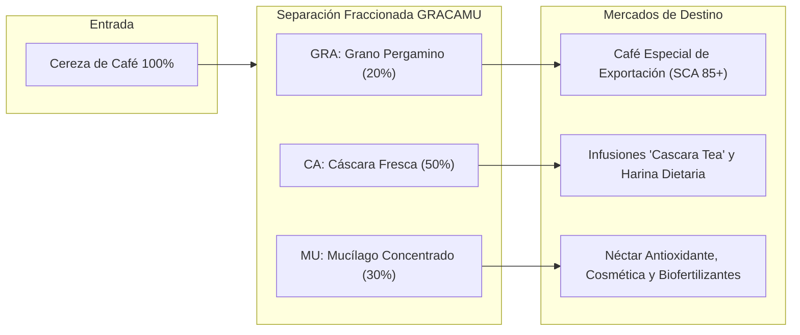

# PROYECTO GRACAMU IKAM 2030: DOSSIER TÉCNICO Y PLAN MAESTRO DE LA PLATAFORMA WEB
### "Caficultura Regenerativa, Bioeconomía Circular y Tecnología Limpia en Origen"
**Subdominio Institucional:** `https://gracamu.idexperujapon.edu.pe/`  
**Institución:** Instituto de Educación Superior Tecnológico Público de Excelencia "Perú Japón" — Chachapoyas, Amazonas  
**Fecha:** Noviembre de 2026  

---

> [!NOTE]
> Este documento consolida en un **único archivo maestro** toda la fundamentación científica, métricas del sector agrario en Amazonas, especificaciones de ingeniería del prototipo autónomo y el plan de desarrollo de la plataforma web. Diseñado para revisión docente, validación institucional y sustentación de proyectos de innovación tecnológica y emprendimiento.

---

## TABLA DE CONTENIDOS
1. [Identidad del Proyecto y Significado de Marca](#1-identidad-del-proyecto-y-significado-de-marca)
2. [Diagnóstico y Radiografía Cafetalera de Amazonas (Métricas Oficiales)](#2-diagnóstico-y-radiografía-cafetalera-de-amazonas-métricas-oficiales)
3. [La Solución Tecnológica: Prototipo Portátil Autónomo GRACAMU IKAM](#3-la-solución-tecnológica-prototipo-portátil-autónomo-gracamu-ikam)
4. [El Modelo de Bioeconomía Circular: GRA - CA - MU](#4-el-modelo-de-bioeconomía-circular-gra---ca---mu)
5. [Cosmovisión Ancestral: El Legado de NÚGKUI y la Selva IKAM](#5-cosmovisión-ancestral-el-legado-de-núgkui-y-la-selva-ikam)
6. [Directorio de Investigadores y Docentes (IDEX Perú Japón)](#6-directorio-de-investigadores-y-docentes-idex-perú-japón)
7. [Benchmarking de Páginas Web del IDEX Perú Japón](#7-benchmarking-de-páginas-web-del-idex-perú-japón)
8. [Plan de Desarrollo de la Landing Page Web](#8-plan-de-desarrollo-de-la-landing-page-web)
9. [Sistema de Mensajería y Encuesta para Caficultores](#9-sistema-de-mensajería-y-encuesta-para-caficultores)
10. [Especificaciones de Software y Cronograma de Trabajo](#10-especificaciones-de-software-y-cronograma-de-trabajo)

---

## 1. IDENTIDAD DEL PROYECTO Y SIGNIFICADO DE MARCA

El proyecto surge como respuesta a la necesidad urgente de tecnificación limpia y bioeconomía circular en los valles cafetaleros de la ceja de selva de Amazonas.

### 1.1. Desglose del Acrónimo GRACAMU
* **GRA = Grano:** Café pergamino de alta especialidad, cosechado y despulpado sin fracturas mecánicas y sin fermentación defectuosa por aguas estancadas.
* **CA = Cáscara:** Rescate de la pulpa deshidratada para la elaboración de harina de café rica en fibra dietaria e infusiones de alta demanda internacional (*Cascara Tea*).
* **MU = Mucílago:** Extracción pura y no diluida del mucílago para el aprovechamiento de azúcares fermentables y polifenoles antioxidantes para la industria nutracéutica, cosmética y biofertilizantes probióticos.

### 1.2. Raíz Cultural IKAM
Inspirado en la voz originaria Awajún **"Ikam"** o **"Ikamyá"**, que designa a la selva viva o bosque nativo. En el ámbito tecnológico del proyecto se traduce como:  
**I**nnovación y **R**ecolección **A**mbiental del **M**ucílago (o Conocimiento y Aprovechamiento del Fruto Integral).

### 1.3. Identidad Gráfica y Cromática
* **Tipografía:** Serifada, sólida y refinada, que transmite la tradición de la caficultura de origen y la formalidad científica.
* **Isotipo:** Grano de café tripartito estilizado entre hojas de selva alta, rodeado por un medallón ornamental con filigrana dorada y frutos rojos de café maduro.
* **Paleta Cromática:**
  * **Rojo Terracota / Borgoña (`#6E1E28`):** Pasión, origen del café maduro y calidez humana.
  * **Dorado / Cobre / Bronce (`#D4A737`):** Calidad superior, valor agregado y excelencia académica.
  * **Verde Selva Amazónica (`#1F4331`):** Biodiversidad, conservación hídrica y sostenibilidad.

---

## 2. DIAGNÓSTICO Y RADIOGRAFÍA CAFETALERA DE AMAZONAS (MÉTRICAS OFICIALES)

### 2.1. Cifras Reales del Ecosistema Cafetalero Regional
Con base en datos del Ministerio de Desarrollo Agrario y Riego (MIDAGRI), el Instituto Nacional de Estadística e Informática (INEI - IV CENAGRO) y la Junta Nacional del Café (JNC):

| Indicador | Cifra Oficial | Relevancia para el Proyecto |
| :--- | :--- | :--- |
| **Productores en Cadena Café/Cacao** | **40,835 registrados** | Inscritos en el Padrón de Productores Agrarios (PPA). |
| **Unidades Productoras de Café** | **Más de 40,000 parcelas** | Distribuidas en ceja de selva y laderas empinadas. |
| **Estructura Agraria** | **> 80% Agricultura Familiar** | Predios menores a 5 hectáreas, con limitaciones de inversión en maquinaria pesada. |
| **Cuencas Cafetaleras Clave** | **5 provincias principales** | Utcubamba, Rodríguez de Mendoza, Bagua, Bongará y Luya. |
| **Asociatividad Cafetalera** | **Más de 45 organizaciones** | Cooperativas activas como COOPARM, APROCAM, Flor de Café, Laguna de los Cóndores. |

### 2.2. La Triple Problemática que Resuelve GRACAMU IKAM

1. **Catástrofe de Aguas Mieles y Contaminación Hídrica:**
   * En el beneficio húmedo tradicional, se emplean entre 20 y 40 litros de agua por cada kilogramo de café pergamino producido.
   * El vertido descontrolado de aguas mieles (mucílago en descomposición con altísima Demanda Bioquímica y Química de Oxígeno) desoxigena los ríos amazónicos, acidifica las aguas superficiales y aniquila la fauna ictiológica.
2. **Pérdida del 80% de la Biomasa del Fruto:**
   * Por cada 100 kg de café cereza recolectado, solo 20 kg corresponden al grano exportable. Los otros **80 kg (cáscara y mucílago)** son botados como basura contaminante, desaprovechando cientos de toneladas de antioxidantes, fructosa natural y fibra.
3. **Presión Normativa Internacional (EUDR - Unión Europea):**
   * El Reglamento sobre Productos Libres de Deforestación (EUDR) y los límites estrictos de agroquímicos exigen a los caficultores peruanos demostrar una producción limpia y regenerativa para no perder sus principales destinos de exportación.

---

## 3. LA SOLUCIÓN TECNOLÓGICA: PROTOTIPO PORTÁTIL AUTÓNOMO GRACAMU IKAM

### 3.1. Concepto Operativo
Un sistema biomecánico compacto, energéticamente autosuficiente y portátil que permite al caficultor despulpar en seco y de manera fraccionada directamente en su parcela de selva alta, sin necesidad de transportar pesadas cargas de cereza a un centro de beneficio distante ni usar una sola gota de agua.

### 3.2. Desglose de Ingeniería de los 4 Módulos

```
                                [ RECOLECCIÓN EN PARCELA ]
                                            │
                                            ▼
                    ┌──────────────────────────────────────────────┐
                    │ 1. TOLVA CON REJILLA SELECTORA (INOX 304)    │
                    │    Elimina ramas, hojas e impurezas de campo │
                    └───────────────────────┬──────────────────────┘
                                            │
                                            ▼
                    ┌──────────────────────────────────────────────┐
                    │ 2. TAMBOR DESPULPADOR DUAL MICROMÉTRICO      │
                    │    Calibración 4 mm a 8 mm (Cero rotura)     │
                    │    Despulpado ecológico en seco (0 L agua)   │
                    └───────┬───────────────┬───────────────┬──────┘
                            │               │               │
                            ▼               ▼               ▼
                     [ GRANO SECO ]   [ CÁSCARA PURA ]  [ MUCÍLAGO ]
```

1. **Módulo de Tolva y Cribado Primario Superior:**
   * Construido en acero inoxidable AISI 304 de grado alimenticio.
   * Rejilla selectora desmontable para evitar el paso de piedras o ramas que desgasten el mecanismo.
2. **Tambor Despulpador Dual Micrométrico:**
   * Cilindro con grabado dentado concéntrico de precisión.
   * Sistema de perilla micrométrica con ajuste de 4 mm a 8 mm para calibrarse en segundos a variedades locales (*Típica, Caturra, Bourbon, Pache*), evitando aplastar los granos.
3. **Módulo Energético Híbrido Tri-Fuente:**
   * **Panel Solar Monocristalino:** Carga fotovoltaica continua mientras se trabaja bajo el sol de campo.
   * **Batería Modular LiFePO4 de 24V:** Batería de litio-ferrofosfato de ciclo profundo, liviana, sin riesgo de explosión térmica y de larga durabilidad (+3,000 ciclos).
   * **Manivela de Tracción Manual de Respaldo:** Permite seguir operando mecánicamente ante días de lluvia continua o baterías agotadas.
4. **Chasis Biomecánico Ergonómico Portador:**
   * Estructura de aleación ligera que redistribuye el peso sobre la zona lumbar mediante arnés acolchado de grado montañismo.
   * Revestimiento textil técnico impermeable *ripstop*, resistente a cortes y lodo en pendientes superiores a 45°.

---

## 4. EL MODELO DE BIOECONOMÍA CIRCULAR: GRA - CA - MU



* **GRA (Grano):** Conserva la integridad física del grano pergamino, alcanzando mejores tazas de especialidad y cumpliendo con estándares de exportación europea.
* **CA (Cáscara):** Posee más antioxidantes que los arándanos; al no mezclarse con agua ni lodo, se deshidrata limpiamente para infusiones y harina funcional sin gluten.
* **MU (Mucílago):** Al extraerse sin agua, mantiene intacta su concentración de polifenoles y azúcares simples, ideales como endulzante natural, insumo para cosméticos regeneradores o bioestimulante foliar.

---

## 5. COSMOVISIÓN ANCESTRAL: EL LEGADO DE NÚGKUI Y LA SELVA IKAM

En la sabiduría ancestral del pueblo Awajún, **NÚGKUI** es el espíritu y deidad de la tierra fértil que enseñó a las mujeres y hombres a cultivar con respeto y equilibrio, sin agotar el bosque (**IKAM**).

El proyecto GRACAMU IKAM asume este principio:
> *"El café no es solo un grano para exportar, es un fruto integral cuyo verdadero valor emerge al proteger la tierra y transformar lo que antes contaminaba: con tecnología limpia, energía solar y respeto en origen, rescatamos la cáscara y el mucílago para dignificar el trabajo de nuestras familias productoras en Amazonas."*

---

## 6. DIRECTORIO DE INVESTIGADORES Y DOCENTES (IDEX PERÚ JAPÓN)

| Estamento | Fotografía Registrada | Nombre Completo | Rol en el Proyecto |
| :--- | :--- | :--- | :--- |
| **Dirección General** | `director-mario-torrejon.jpg` | **Dr. Mario Y. Torrejón Arellanos** | Director General del IESTP Perú Japón — Respaldo y liderazgo institucional. |
| **Dirección de Incubadora** | `incubadora-jose-alejos.jpg` | **Mg. Jose Magno Alejos Salazar** | Director de la Incubadora Perú Japón StartUp — Mentoría en modelo de negocio, transferencia y escalamiento regional. |
| **Docente Asesor** | `docente-otto-mori.jpg` | **Ing. Otto Mori Tuesta** | Asesor Agroindustrial, Bioeconomía y Sostenibilidad. |
| **Docente Asesor** | `docente-manuel-quispe.jpg` | **Dr. Manuel Jesús Quispe Narváez** | Asesor Metodológico e Investigación Científica. |
| **Docente Asesor** | `docente-roberto-alvarado.jpg` | **Ing. Roberto Carlos Alvarado Pereyra**| Mentor de Innovación Tecnológica, FabLab e Incubación Start Up. |
| **Docente Asesor** | `docente-gerson-vega.jpg` | **Pt. Gerson Daniell Vega Caro** | Asesor Técnico, Ingeniería Mecánica Aplicada y Calibración del Prototipo. |
| **Estudiante Creador** | `estudiante-anderson-santiago.jpg` | **Anderson Santiago Yalta** | Desarrollo Tecnológico y Arquitectura de Sistemas. |
| **Estudiante Creador** | `estudiante-joselito-cuvaz.jpg` | **Cuvaz Briceño Laison Joselito** | Validación Técnica de Campo y Pruebas Operativas. |
| **Estudiante Creador** | `estudiante-royler-huaman.jpg` | **Huamán Arévalo Royler** | Procesamiento de Bioproductos y Difusión Agraria. |
| **Estudiante Creador** | `estudiante-cleiser-zumaeta.jpg` | **Zumaeta Cuchca Cleiser** | Investigación y Campo. |
| **Estudiante Creador** | `estudiante-jharel-arana.jpg` | **Jharel Andre Arana Vargas** | Arquitectura Web y Sistemas. Diseño de la plataforma web, arquitectura del sistema de encuestas y vinculación con caficultores. |

---

## 7. BENCHMARKING DE PÁGINAS WEB DEL IDEX PERÚ JAPÓN

Se revisaron en profundidad los tres sitios de referencia institucional existentes:

1. **UCHINUATECH-B (`https://uchinuatech-b.idexperujapon.edu.pe/`):**
   * *Fortalezas:* Enfoque claro en salud infantil, botón a bot externo (Poe) y documento PDF compartido por Google Drive.
   * *Oportunidades de mejora:* Depende de un constructor estático rígido con estilos embebidos pesados.
2. **PHURUTECH (`https://phurutech.idexperujapon.edu.pe/`):**
   * *Fortalezas:* Excelente concepto de economía circular (residuos avícolas y energía solar).
   * *Oportunidades de mejora:* Línea de tiempo con contenido de prueba y carencia de un sistema de captación de interesados interactivo.
3. **IÑATECH (`https://inatech.idexperujapon.edu.pe/`):**
   * *Fortalezas:* El desarrollo más limpio y estilizado del instituto. Tema oscuro con acentos bambú (`#f4d77c`), tipografía cuidada (`Inter` y `Fraunces`), modularidad semántica y excelente panel fotográfico.
   * *Oportunidades de mejora:* Enlaces de contacto puramente pasivos (no capturan datos de los visitantes).

### Nuestra Ventaja Competitiva para GRACAMU:
Adoptaremos la elegancia y modularidad de **IÑATECH**, pero potenciada con la moderna pila tecnológica de **Laravel 12 + Tailwind CSS**, agregando un **sistema de captación activo (WhatsApp directo + base de datos local)** para caficultores de la región.

---

## 8. PLAN DE DESARROLLO DE LA LANDING PAGE WEB

### 8.1. Estructura de las Secciones del Sitio

```
┌────────────────────────────────────────────────────────────────────────┐
│ HEADER: Logo GRACAMU IKAM | Menú Flotante | Sello IDEX | Botón Contacto │
├────────────────────────────────────────────────────────────────────────┤
│ HERO SECTION:                                                          │
│ - Título: Caficultura Regenerativa y Bioeconomía Circular en Amazonas  │
│ - Métricas Rápidas: 0 Litros de Agua | 100% Solar | 80% Biomasa        │
│ - Llamados a la Acción (CTA)                                          │
├────────────────────────────────────────────────────────────────────────┤
│ PROBLEMÁTICA REGIONAL:                                                 │
│ - 40,835 Familias Cafetaleras (MIDAGRI / INEI)                         │
│ - La contaminación por Aguas Mieles en los ríos de Amazonas            │
│ - La exigencia de la Normativa Europea EUDR                            │
├────────────────────────────────────────────────────────────────────────┤
│ PROTOTIPO GRACAMU IKAM:                                                │
│ - Ficha Técnica de Ingeniería (Tolva, Tambor, Solar, Chasis Portador)  │
├────────────────────────────────────────────────────────────────────────┤
│ MODELO GRA - CA - MU:                                                  │
│ - Grano (Café Especial) | Cáscara (Infusión) | Mucílago (Bioproducto)  │
├────────────────────────────────────────────────────────────────────────┤
│ IDENTIDAD CULTURAL: Raíces Awajún, NÚGKUI y la Selva IKAM              │
├────────────────────────────────────────────────────────────────────────┤
│ DIRECTORIO DEL EQUIPO IDEX:                                            │
│ - Tarjetas fotográficas uniformadas del Director, Docentes y Alumnos   │
├────────────────────────────────────────────────────────────────────────┤
│ ALIANZAS Y ENCUESTA REGIONAL:                                          │
│ - Formulario de registro para Fincas y Cooperativas                    │
│ - Botón Instantáneo de WhatsApp con mensaje estructurado               │
├────────────────────────────────────────────────────────────────────────┤
│ FOOTER INSTITUCIONAL: Dirección Jr. Amazonas 120, Chachapoyas          │
└────────────────────────────────────────────────────────────────────────┘
```

---

## 9. SISTEMA DE MENSAJERÍA Y ENCUESTA PARA CAFICULTORES

Para atender el requerimiento de comunicación directa con productores de la región, se han implementado dos mecanismos complementarios:

### 9.1. Sistema A: Envío Directo a WhatsApp (Instantáneo y Sin Costo)
Permite que un caficultor o representante de cooperativa complete campos clave en el formulario:
* Nombre del productor o institución
* Zona o cuenca (Bagua, Utcubamba, Rodríguez de Mendoza, Luya, Bongará)
* Número de hectáreas de café
* Tipo de consulta (Solicitar demostración en finca, propuesta de compra de cáscara/mucílago, etc.)

Al hacer clic en **"Enviar por WhatsApp"**, el sistema compila la información y abre automáticamente la aplicación con un mensaje formal:

```text
🌿 *NUEVA CONSULTA - PROYECTO GRACAMU IKAM*
👤 *Nombre:* Juan Mendoza
📍 *Ubicación / Cooperativa:* Rodríguez de Mendoza (Finca Santa Rosa)
🌱 *Hectáreas cultivadas:* 4 ha (Variedad Caturra y Típica)
💬 *Mensaje:* Deseo solicitar una prueba del prototipo de despulpado en seco en mi cosecha.
```

### 9.2. Sistema B: Registro en Base de Datos Laravel
Al pulsar **"Registrar en el Proyecto"**, los datos se validan contra el controlador `ContactController` y se almacenan de forma segura en la tabla `contacts` de la base de datos interna, permitiendo a los estudiantes llevar una bitácora estadística de productores interesados.

---

## 10. ESPECIFICACIONES DE SOFTWARE Y CRONOGRAMA DE TRABAJO

### 10.1. Stack Tecnológico
* **Lenguaje y Framework:** PHP 8.5 / Laravel 12.
* **Framework CSS:** Tailwind CSS v4 con variables semánticas personalizadas.
* **Empaquetador de Assets:** Vite 8.
* **Persistencia de Datos:** SQLite / MySQL con migraciones controladas.
* **Diseño Responsivo:** Enfoque *Mobile-First*, adaptado para teléfonos de gama media y tabletas utilizadas en el campo.

### 10.2. Cronograma de Fases

| Fase | Tarea Principal | Estado |
| :--- | :--- | :--- |
| **Fase 1** | Formulación de Dossier Técnico, Métricas y Plan Web | **Completado (100%)** |
| **Fase 2** | Estructuración de Base de Datos y Modelo `Contact` | **Completado (100%)** |
| **Fase 3** | Maquetación de la Vista Principal (`gracamu.blade.php`) | **En Curso** |
| **Fase 4** | Integración del Generador de WhatsApp y Validaciones | **Pendiente** |
| **Fase 5** | Revisión Final y Despliegue en Subdominio IDEX | **Pendiente** |

---

*Proyecto respaldado por el Instituto de Educación Superior Tecnológico Público de Excelencia Perú Japón — Chachapoyas, Amazonas, Perú.*

